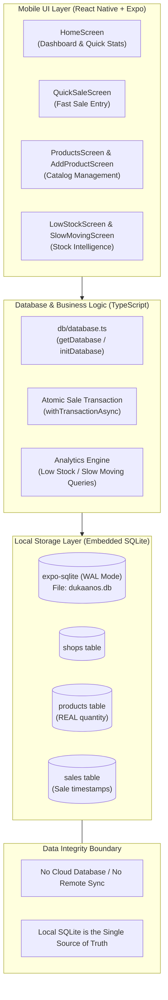

# DukaanOS

> **Offline-first smart inventory management for Indian kirana stores.**  
> *आपकी दुकान का सरल और सुरक्षित डिजिटल मुनीम — बिना इंटरनेट, सीधे आपके फ़ोन पर।*

[](https://reactnative.dev/)
[](https://expo.dev/)
[](https://www.typescriptlang.org/)
[](https://docs.expo.dev/versions/latest/sdk/sqlite/)
[](#technical-architecture)

---

## Table of Contents

- [Overview](#overview)
- [Key Features](#key-features)
- [Technical Architecture](#technical-architecture)
- [Database Schema & Integrity](#database-schema--integrity)
- [Project Structure](#project-structure)
- [Getting Started / Local Setup](#getting-started--local-setup)
- [Android Standalone APK Build](#android-standalone-apk-build)
- [Offline Verification & Testing](#offline-verification--testing)
- [Planned AI Integration (Gemma + Ollama)](#planned-ai-integration-gemma--ollama)
- [Reproducible Demo Flow](#reproducible-demo-flow)
- [Design Philosophy](#design-philosophy)
- [Known Limitations & Roadmap](#known-limitations--roadmap)
- [License](#license)
- [Contributing](#contributing)

---

## Overview

### The Kirana Problem
India's 12+ million small neighbourhood retail shops (*kirana stores*) form the backbone of everyday commerce. However, shopkeepers face unique operating hurdles:
- **Paper Bahi-Khata & Mental Math:** Tracking loose products, bulk sacks, and sales in paper notebooks leads to arithmetic errors and lost inventory.
- **Stockouts during Peak Hours:** Shopkeepers often discover that fast-selling commodities (such as milk, rice, or sugar) are out of stock only when a customer asks for them.
- **Dead Capital in Slow-Moving Items:** Capital gets tied up in inventory that has not moved for weeks or months, with no visibility into sales velocity.
- **Erratic Internet Connectivity:** Cloud-first SaaS solutions, complex POS software, and web dashboards fail in basement shops, dense market alleys, or rural areas with poor connectivity.
- **Complex UI:** Typical ERP systems are built for desktop screens with English-only corporate jargon, alienating busy retailers who operate one-handed on mobile devices.

### How DukaanOS Solves It
**DukaanOS** is an ultra-fast, offline-first mobile inventory operating system built specifically for kirana retailers.
- **Zero Internet Requirement:** Every screen, query, and transaction runs 100% locally on the device using an embedded SQLite database.
- **Quick Sale in Seconds:** Tap a product, type quantity, and hit enter. Stock decrements atomically with instant visual feedback.
- **Fractional Quantities Native to Kirana:** Seamlessly handles fractional quantities (e.g., `3.5 kg`, `0.5 litre`, `250 g`) without rounding errors.
- **Automatic Stock Intelligence:** Identifies items reaching their low-stock threshold and highlights slow-moving products with zero manual record checking.
- **Bilingual & Ergonomic:** Dual-language English and Hindi labels, large 48dp+ tap targets, and high-contrast typography designed for busy store counters.

---

## Key Features

### Core Implemented Features

| Feature | Description | Status |
| :--- | :--- | :---: |
| **Store Profile Setup** | First-time guided setup for shop name, shop category (Kirana/General), and language preferences. | ✅ Implemented |
| **Product Catalog Management** | Add and view items with name, unit, opening stock, and custom low-stock threshold. | ✅ Implemented |
| **Fractional Quantity Engine** | Native support for decimal quantities across `kg`, `g`, `litre`, `ml`, `pcs`, `packet`, and `box`. | ✅ Implemented |
| **Quick Sale (⚡)** | Rapid sale recording interface with search filter, instant numeric keypad, and one-tap stock update. | ✅ Implemented |
| **Atomic Stock Decrement** | ACID-compliant SQLite transactions guarantee stock drops instantly when a sale is confirmed. | ✅ Implemented |
| **Overselling Guard** | Prevents selling more stock than available; strictly blocks negative inventory states. | ✅ Implemented |
| **Low Stock Alerts (⚠)** | Auto-calculates `quantity <= threshold`; prioritizes `OUT OF STOCK` (0 quantity) items at the top. | ✅ Implemented |
| **Slow-Moving Analytics (🐌)** | Identifies dead capital by detecting products with no sales in 30+ days or `NEVER SOLD`. | ✅ Implemented |
| **Local SQLite Persistence** | On-device `expo-sqlite` database with Write-Ahead Logging (`PRAGMA journal_mode = WAL`). | ✅ Implemented |
| **Bilingual UI / Hinglish** | Hindi + English dual labels (`जल्दी बिक्री`, `कम स्टॉक`, `धीमी बिक्री`) with intuitive icons. | ✅ Implemented |
| **Standalone Android APK** | Production build configuration (`eas.json` + `app.json`) requiring no Expo Go or development servers. | ✅ Implemented |

---

## Technical Architecture

DukaanOS follows a strict **Offline-First Local Storage Architecture**. The device's local SQLite database serves as the absolute source of truth.



### Key Architectural Principles
1. **SQLite is the Single Source of Truth:** All inventory levels, sales records, and shop profiles reside in local SQLite tables. No network call is ever made for data reads or writes.
2. **Transaction Atomicity:** Sales and inventory deductions are wrapped inside `withTransactionAsync`. A sale record cannot be created unless the product's stock is successfully deducted in the same atomic commit.
3. **Floating-Point Precision Guard:** Real weights (e.g. `20 kg - 3.5 kg = 16.5 kg`) are rounded to 6 decimal places during calculation to prevent IEEE-754 binary floating-point artifacts.
4. **Decoupled AI Boundary:** Any current or planned AI functionality acts strictly in an advisory capacity. **AI models do not directly mutate database rows.**

---

## Database Schema & Integrity

The app uses `expo-sqlite` managing a local database named `dukaanos.db`. Schema initialization is idempotent (`CREATE TABLE IF NOT EXISTS`) and automatically runs on startup.

### 1. `shops` Table
Stores retail store identity and configuration:
```sql
CREATE TABLE IF NOT EXISTS shops (
  id INTEGER PRIMARY KEY AUTOINCREMENT,
  shop_name TEXT NOT NULL,
  shop_type TEXT NOT NULL DEFAULT 'kirana',
  language TEXT NOT NULL DEFAULT 'en',
  created_at TEXT NOT NULL DEFAULT (datetime('now'))
);
```

### 2. `products` Table
Stores product inventory with decimal support (`REAL`):
```sql
CREATE TABLE IF NOT EXISTS products (
  id INTEGER PRIMARY KEY AUTOINCREMENT,
  name TEXT NOT NULL,
  quantity REAL NOT NULL DEFAULT 0,
  unit TEXT NOT NULL DEFAULT 'pcs',
  low_stock_threshold REAL NOT NULL DEFAULT 5,
  created_at TEXT NOT NULL DEFAULT (datetime('now')),
  updated_at TEXT NOT NULL DEFAULT (datetime('now'))
);
CREATE INDEX IF NOT EXISTS idx_products_name ON products(name);
```

### 3. `sales` Table
Stores historical sale transactions:
```sql
CREATE TABLE IF NOT EXISTS sales (
  id INTEGER PRIMARY KEY AUTOINCREMENT,
  product_id INTEGER NOT NULL,
  quantity REAL NOT NULL,
  created_at TEXT NOT NULL DEFAULT (datetime('now')),
  FOREIGN KEY (product_id) REFERENCES products(id)
);
CREATE INDEX IF NOT EXISTS idx_sales_product_id ON sales(product_id);
```

---

## Project Structure

```text
DukaanOS/
├── app/                        # Main Application Screens
│   ├── AddProductScreen.tsx    # Add new inventory item with unit & threshold
│   ├── HomeScreen.tsx          # Store dashboard, summary metrics, quick actions
│   ├── LowStockScreen.tsx      # Filtered view for items at or below threshold
│   ├── ProductsScreen.tsx      # Searchable, full product catalog with stock badges
│   ├── QuickSaleScreen.tsx     # Tap-to-sell interface with numeric keyboard
│   ├── ShopSetupScreen.tsx     # Onboarding & store configuration profile
│   ├── SlowMovingScreen.tsx    # Items with no sales in 30+ days or never sold
│   └── index.ts                # Screen exports barrel
├── assets/                     # App icons, splash screens, and adaptive assets
├── components/                 # Reusable UI components
│   ├── OfflineBadge.tsx        # Persistent offline-first status indicator
│   └── index.ts                # Component exports barrel
├── constants/                  # Design tokens and localizations
│   ├── index.ts                # Constants exports barrel
│   ├── strings.ts              # Bilingual (English/Hindi) UI string dictionary
│   └── theme.ts                # Forest Green color palette, spacing, 48dp touch targets
├── db/                         # Database access and query services
│   ├── database.ts             # SQLite initialization, migrations, CRUD, and transactions
│   └── index.ts                # DB exports barrel
├── types/                      # TypeScript definitions
│   └── index.ts                # Product, Sale, Shop, Screen, and Unit type contracts
├── App.tsx                     # Root component managing screen routing & state
├── app.json                    # Expo configuration with Android package identifier
├── eas.json                    # EAS configuration for standalone Android APK builds
├── index.ts                    # Application entry point
├── package.json                # Project dependencies and npm scripts
└── tsconfig.json               # TypeScript strict compiler configuration
```

---

## Getting Started / Local Setup

### Prerequisites
- **Node.js:** `v18.x` or `v20.x` or later
- **npm:** `v9.x` or later
- **Expo CLI:** Available via `npx expo`
- **Hardware:**
  - Android phone with USB debugging enabled OR
  - Android Studio Emulator OR
  - Physical phone running the Expo Go app (for development only)

### Installation Steps

1. **Clone the repository:**
   ```bash
   git clone https://github.com/gangotrigupta-61/DukaanOS.git
   cd DukaanOS
   ```

2. **Install dependencies:**
   ```bash
   npm install
   ```

3. **Verify TypeScript compilation:**
   ```bash
   npx tsc --noEmit
   ```

4. **Verify Android bundle generation:**
   ```bash
   npx expo export -p android --no-bytecode
   ```

5. **Start the development server:**
   ```bash
   npm start
   # or
   npx expo start
   ```

6. **Run on Android:**
   - Press `a` in the terminal to launch on a connected Android device or emulator.
   - Or press `w` to launch the web preview.

---

## Android Standalone APK Build

DukaanOS is configured to build a **real standalone Android `.apk`** file that installs directly onto physical phones and runs without Expo Go, Metro, or a computer.

### EAS Build Configuration
The repository includes an internal APK build profile in `eas.json`:
```json
{
  "cli": {
    "version": ">= 12.0.0"
  },
  "build": {
    "preview": {
      "distribution": "internal",
      "android": {
        "buildType": "apk"
      }
    }
  }
}
```

### Steps to Build Standalone APK

1. **Log in to Expo Application Services (EAS):**
   ```bash
   npx eas-cli login
   ```

2. **Trigger the preview APK build:**
   ```bash
   npx eas-cli build -p android --profile preview
   ```

3. **Download and Install:**
   - Once the cloud build completes, copy the generated download URL or scan the terminal QR code from your Android device.
   - Download the `.apk` file and tap to install.
   - Allow "Install from Unknown Sources" if prompted by Android.

---

## Offline Verification & Testing

To confirm that the app operates with zero internet dependence, perform this validation test:

### Verification Protocol

1. **Prepare Device:**
   - On your Android phone, turn **Wi-Fi OFF** and **Mobile Data OFF** (or turn **Airplane Mode ON**).
2. **Launch Application:**
   - Open **DukaanOS** directly from your app drawer.
   - Confirm that the app opens instantly with no server connection spinners or network timeout warnings.
   - Confirm that the `Offline • बिना इंटरनेट` badge appears.
3. **Execute Core Workflows:**
   - **Shop Profile:** Save `Gupta General Store` (`Kirana`).
   - **Catalog Entry:** Add `Basmati Rice`, quantity `20 kg`, alert threshold `5 kg`.
   - **Quick Sale:** Open Quick Sale, select `Basmati Rice`, sell `3.5 kg`.
   - **Verify Stock:** Return to Products list. Verify stock reads `16.5 kg`.
   - **Stockout Test:** Sell the remaining `16.5 kg`. Confirm stock drops to `0 kg` and status changes to `OUT OF STOCK`.
   - **Low Stock Screen:** Navigate to `Low Stock`. Confirm `Basmati Rice` appears under Out of Stock.
   - **Slow Moving Screen:** Navigate to `Slow Moving`. Confirm items with no sales appear with `NEVER SOLD` tags.
4. **Data Persistence Test:**
   - Force-close and swipe away DukaanOS from the Android recent apps switcher.
   - Keep the phone in **Airplane Mode**.
   - Reopen DukaanOS.
   - Verify that all shop details, product lists, remaining quantities, and sales logs remain intact in local SQLite.

---

## Planned AI Integration (Gemma + Ollama)

> [!NOTE]
> **Status: Planned Architecture / Future Milestone**  
> Core inventory tracking and rule-based insights are fully implemented and running on SQLite. The AI assistant layer is architected as an optional offline copilot.

### Proposed Architecture

```text
┌───────────────────────────────────────────────┐
│           DukaanOS Mobile Frontend            │
└───────────────────────┬───────────────────────┘
                        │ HTTP / JSON
                        ▼
┌───────────────────────────────────────────────┐
│     Local Ollama Server (LAN / On-Device)     │
│             Model: gemma:2b                   │
└───────────────────────┬───────────────────────┘
                        │ Read-Only Context
                        ▼
┌───────────────────────────────────────────────┐
│    Local SQLite Database (dukaanos.db)        │
│          ★ SINGLE SOURCE OF TRUTH ★           │
└───────────────────────────────────────────────┘
```

### Integration Design & Boundaries
- **Runtime:** Ollama running locally serving `gemma:2b` or quantized Gemma checkpoints.
- **Strict Read-Only Context:** DukaanOS extracts aggregate summaries (e.g., `"5 items low stock, 3 items unsold in 30 days"`) and prompts the model for plain-language replenishment advice.
- **No Direct Schema Mutation:** The AI copilot will **never** execute raw `UPDATE` or `DELETE` SQL queries. All stock changes require explicit human confirmation through the standard UI transaction pipeline.
- **Graceful Fallback:** If Ollama is unreachable or offline, DukaanOS falls back smoothly to its built-in SQLite deterministic analytics without displaying errors or interrupting checkout.

---

## Reproducible Demo Flow

To demonstrate the complete lifecycle of DukaanOS to judges or evaluators:

```text
1. Shop Setup
   Shop Name: Gupta General Store
   Shop Type: Kirana
   Language: Bilingual / Hinglish

2. Add Initial Products
   • Basmati Rice      →  20 kg      (Threshold: 5 kg)
   • Sugar             →  10 kg      (Threshold: 3 kg)
   • Milk              →  5 litre    (Threshold: 2 litre)
   • Parle-G Biscuits  →  24 packet  (Threshold: 6 packet)

3. Perform Quick Sales
   • Sell 3.5 kg Basmati Rice   ──▶ Stock updates to 16.5 kg
   • Sell 10 kg Sugar           ──▶ Stock hits 0 kg (OUT OF STOCK)
   • Attempt to sell 6 L Milk   ──▶ Guard triggers: "Not enough stock"

4. Check Inventory Intelligence
   • Open "Low Stock"          ──▶ Sugar shows OUT OF STOCK (Top priority)
   • Open "Slow Moving"        ──▶ Parle-G shows NEVER SOLD (Dead capital warning)

5. Offline Verification
   • Turn Airplane Mode ON      ──▶ App continues running flawlessly
   • Force-close & Relaunch     ──▶ 100% data restored from SQLite
```

---

## Design Philosophy

- **100% Offline-First:** We treat internet connectivity as an optional luxury, not a prerequisite. Data lives on the retailer's physical device.
- **48dp+ Minimum Touch Targets:** All buttons, counter pills, and inputs respect a minimum 48dp touch footprint (`Touch.minTarget = 48`) so shopkeepers can tap accurately while standing behind a busy counter.
- **High-Contrast Forest Green Palette:** Clean visual hierarchy (`#1B5E20` primary, `#FBF9F5` warm paper background) optimized for legibility under harsh fluorescent shop lighting and low-cost Android displays.
- **Dignified Bilingual Support:** Natural Hinglish terminology (`जल्दी बिक्री`, `सामान सूची`, `कम स्टॉक`) that speaks the language of Indian retailers without patronizing or using awkward machine translations.

---

## Known Limitations & Roadmap

### Current Limitations
- **Local Storage Scope:** Data is saved locally in SQLite on the active device. Uninstalling the app removes local application storage until Backup/Restore is released.
- **Single-Device Operation:** Designed for single-counter standalone stores; multi-device distributed checkout is not yet supported.

### Roadmap
- [ ] **Encrypted Local Backup:** One-tap encrypted SQLite backup/restore to local device storage, SD card, or local Wi-Fi share.
- [ ] **Bluetooth Thermal Printer Integration:** Instant receipt printing for customers via standard ESC/POS Bluetooth printers.
- [ ] **Barcode Scanning:** Camera-based offline UPC/EAN barcode lookup for packaged FMCG goods.
- [ ] **Embedded SLM Assistant:** Local on-device execution of Gemma via ExecuTorch or Ollama for voice-assisted inventory queries.

---

## License

This repository does not currently contain a standalone `LICENSE` file. All rights are reserved by the repository maintainer ([gangotrigupta-61](https://github.com/gangotrigupta-61/DukaanOS)). Contact the repository owner for licensing terms or open-source distribution details.

---

## Contributing

Contributions, feedback, and issue reports are welcome!

1. Fork the repository.
2. Create a descriptive feature branch:
   ```bash
   git checkout -b feature/your-feature-name
   ```
3. Verify your changes pass all local static checks:
   ```bash
   npx tsc --noEmit
   npx expo export -p android --no-bytecode
   ```
4. Commit your changes and push your branch:
   ```bash
   git push origin feature/your-feature-name
   ```
5. Open a Pull Request detailing your modifications and validation steps.